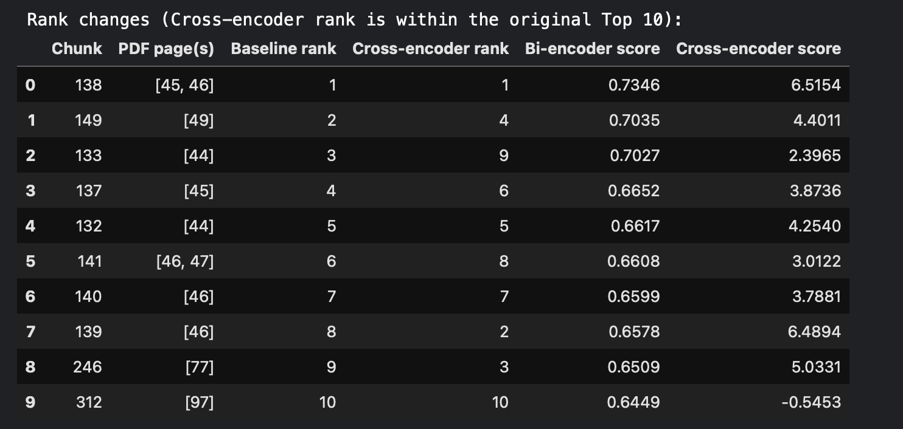
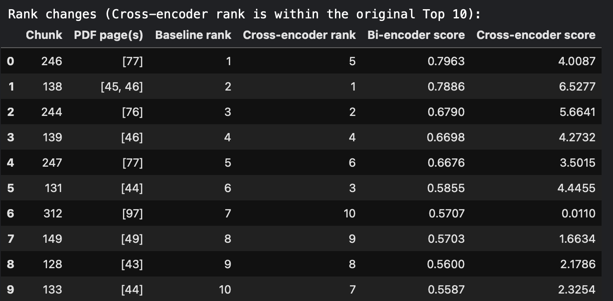
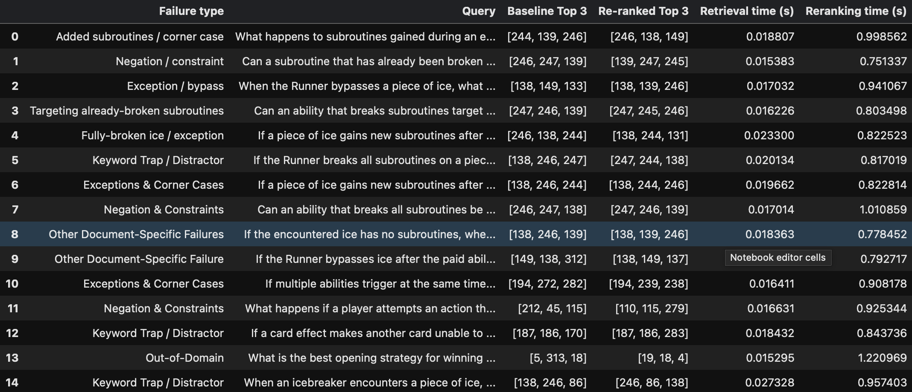

# Report

## 1. Architecture Comparison: 
- A bi-encoder encodes the query and each document chunk separately into embeddings, then compares them using cosine similarity. A cross-encoder processes the query and a document chunk together, using joint self-attention to understand how their words relate and assign a relevance score.

## 2. Qualitative & Rank Shift Analysis:
### Failure 1:
```
FAILURE TYPE: Exception / bypass
QUERY: When the Runner bypasses a piece of ice, what happens to the encounter and its subroutines?

--- BASELINE ANSWER ---

Based on the provided context, when an effect allows the Runner to bypass a piece of ice, the Encounter Ice Phase is aborted and the Runner immediately proceeds to pass that ice. 

The provided context does not contain enough information to determine what specifically happens to the encounter's subroutines when the ice is bypassed.

--- RE-RANKED ANSWER ---

Based on the provided context, when the Runner bypasses a piece of ice, the Encounter Ice Phase is aborted and the Runner immediately proceeds to pass that ice. 

Regarding the subroutines:
- For most bypass effects (which occur at the beginning of an encounter), subroutines on the encountered ice are neither broken nor resolved.
- If a bypass effect is triggered later (in step 6.9.3b), subroutines may or may not have been broken, but because step 6.9.3c never occurs, no subroutines resolve.

LLM latency — baseline: 1.096 s; re-ranked: 0.811 s 
```


- The baseline top 3 chunks are not reranked in the top, and the reranked top 3 chunks seem to have more information, which clearly lead to more detailed output for the reranked output compared to baseline. This lead to baseling omitting the part of the required answer.
### Failure 2:
```
FAILURE TYPE: Fully-broken ice / exception
QUERY: If a piece of ice gains new subroutines after the Runner has fully broken it, does the Runner lose the fully-broken status, and can breaking those new subroutines fully break it again?

--- BASELINE ANSWER ---

Based on the provided context:

- The Runner does **not** lose the status of having fully broken the ice; that status remains in place. 
- Breaking the new subroutines will **not** fully break the ice or meet related conditions again.

--- RE-RANKED ANSWER ---

Based on the provided context:

- No, the Runner does not lose the status of having fully broken the ice; the status remains in place.
- No, breaking those new subroutines will not fully break the ice or meet related conditions again.

LLM latency — baseline: 0.674 s; re-ranked: 0.610 s
```

- In the baseline, top 3 are different from the top 3 in the advanced pipeline, this can be viewed from the above the image of the chunk ordering.
- The advanced answer was more spot on, compared to baseline.


## 3. Latency Profiling:

- This above table shows the retrieval time for baseline pipeline (bi-encoder) vs advanced pipeline (bi-encoder + cross-encoder reranker).
- From the above table we can clearlt see that the advanced pipeline is slower compared to the baseline pipeline, because it involves reranking of top 10 results from the baseline pipeline using cross-encoder as extra on top of baseline.
- Now for the answer generation between both pipelines, since they used same llm and same number of chunks as context, so there was not much difference in answer generation.
- The main difference in latency in the pipelines is mainly in the chunking part of the pipeline.

## 4. Scaling Question:
- A cross-encoder reads the query and document chunk together. This helps it to decide how well the chunk matches the query. But it must score each query–chunk pair separately. So, using it on a large collection like entire document collection from the very start takes more time and computing power.

Whereas, a bi-encoder creates embeddings for the query and each document chunk separately. The chunk embeddings can be saved in advance. This will make searching faster.

## 5. Github Link:
- https://github.com/SaiVeekshithKotha/RAG-Assignment-LMA.git
- https://www.kaggle.com/code/ksaiveekshith3306/lma-assignment